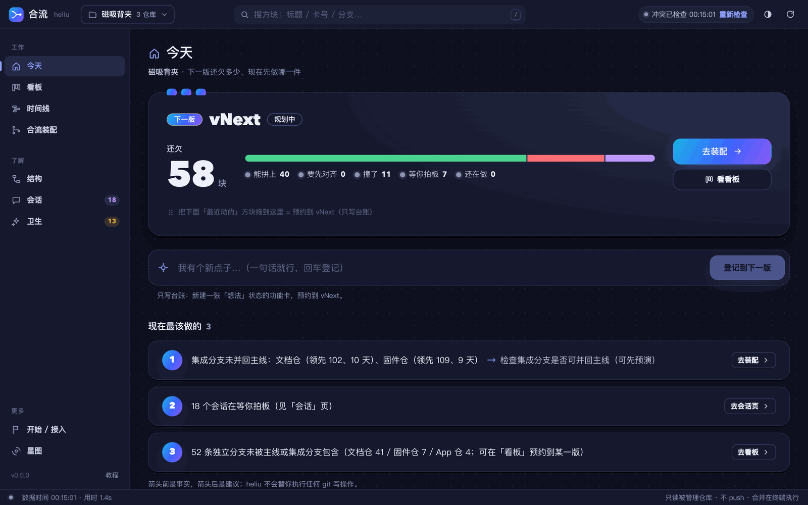
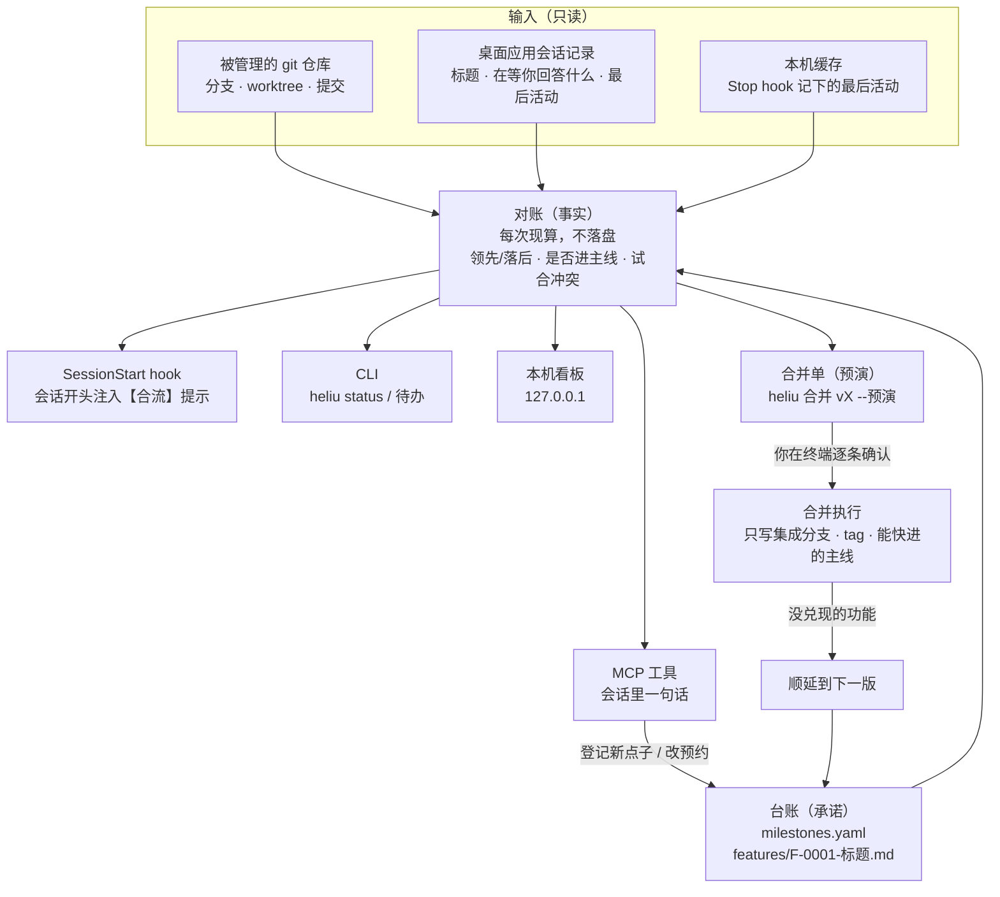

<a id="top"></a>

# 合流（heliu）— 十几个 AI 会话并行开发，每一版还欠什么一眼看清

[](package.json)


[](tests/)


**合流是一个本机运行的中文版本台账**：它把 git 分支、worktree 和 Claude 桌面应用里的会话对上账，让你随口说的新点子变成功能卡、预约到某一版。
**它解决的是「并行开了十几个会话之后，一版到底还欠什么、哪些能合、哪些在等我」**：看板 10 秒看懂，合并按版本走预演 → 确认 → 合入 → 顺延，不漏、不乱、不偷偷动你的仓库。
**一句话：git 是事实，台账是承诺，看板是对账单。**

<p align="center">
  <a href="#快速开始"><strong>快速开始</strong></a> ·
  <a href="docs/教程.md"><strong>使用教程</strong></a> ·
  <a href="#命令速查"><strong>命令速查</strong></a> ·
  <a href="#工作原理"><strong>工作原理</strong></a> ·
  <a href="#安全承诺"><strong>安全承诺</strong></a> ·
  <a href="#验证状态"><strong>验证状态</strong></a> ·
  <a href="#文档索引"><strong>文档</strong></a> ·
  <a href="#已知限制"><strong>已知限制</strong></a>
</p>

<picture>
  <source media="(prefers-color-scheme: dark)" srcset="docs/assets/home-dark.png">
  
</picture>

<p align="center"><sub>「今天」页，浅色 / 深色随系统切换。数据来自真实项目「磁吸背夹」（3 个仓库、61 张功能卡），2026-11-01 截图。</sub></p>

## 不碰终端就能上手

装好之后有两种不碰终端的打开方式，都落在「开始」页：

- **合流 App**：在合流目录运行一次 `scripts/build-app.sh --install`（要有 Xcode 命令行工具），之后在启动台或聚焦搜索里打开「合流」。它是一个原生 macOS 窗口，自己在后台启动看板、退出时一起关掉，不开终端、不开浏览器；用的是主仓库的代码，`git pull` 之后重开就是新版。说明见 [app/macos/README.md](app/macos/README.md)。
- **「合流看板.command」**：在 Finder 里双击仓库根目录的这个文件，会开一个终端窗口跑看板，并打开浏览器。

合流长得像一个本地客户端：左侧栏选页面，中间是一块块积木，点任何一块右侧滑出详情，底部状态栏写着数据时间。

**一种方块，到处一样。** 每条功能（有卡的功能卡、还没登记的分支）在所有页面里都是同一个方块：顶上两颗「积木钉」的颜色就是状态，第一行永远是人话，事实放在小字和芯片里。

| 钉的颜色 | 人话 | 意思 |
|---|---|---|
| 绿 | 能拼上 | 试合无冲突，或已经进了集成分支 |
| 黄 | 要先对齐 | 分支落后基线，合并前先同步 |
| 红 | 撞了 | 试合有冲突文件，芯片上写着几个 |
| 紫 | 等你拍板 | 会话停下来在等你回答，原话就在方块上 |
| 灰 | 还在做 / 没动静 N 天 / 还没绑分支 | 开发中，或很久没动 |
| 蓝 | 还没登记 | 有分支、没功能卡，拖到版本上就登记 |

四个主页面：

- **今天**：第一眼看懂下一版还欠多少块、几块能拼上、几块等你；「我有个新点子…」一句话回车就登记；「现在最该做的」每句一个按钮；「最近动的」六块可以直接拖到上面的「下一版」大方块里预约。
- **看板**：一列一个版本。把方块拖到别的列就是预约，松手写台账、toast 里有「撤销」；拖到已发布的列会被拒绝并说明原因。列内按 等你拍板 → 撞了 → 能拼上 → 要先对齐 → 还在做 分组折叠，列头有「还欠 N」和分段条。
- **时间线**：左边是 仓库 → 模块 → 方块 的 WBS 树，右边是时间轴：每块什么时候在动、今天在哪、里程碑日期线在哪。起点拿不到精确值时画虚线并写明「近似」。把一条拖到顶部的版本芯片 = 预约；没登记的分支拖过去 = 顺手建卡。
- **合流装配**：像拼积木一样把这一版的方块摆上「合流轨道」。左边按 能拼上 / 已在集成分支 / 撞了 / 没试出来 / 还没做完 / 拼不上 分堆，右边的轨道从上到下就是合并顺序，每个槽位有 并入 / 待定 / 不并 / 顺延 开关。拖进轨道、切开关都只写合并单；底部常驻「生成合并单」「复制合并 Prompt」，并一直写着：**看板只排单，不执行合并，在终端运行 `heliu 合并 <版本>`、输入 yes 才开始。**

| 在哪里拖 | 放到 | 发生什么 |
|---|---|---|
| 今天 · 最近动的方块 | 「下一版」大方块 | 预约到下一版 |
| 看板 · 方块 | 另一列 | 改预约（拖到「未预约」= 取消预约） |
| 时间线 · 一条 | 顶部的版本芯片 | 预约；没登记的分支会先建卡 |
| 时间线 · 一条 | 左栏的模块名 | 改模块 |
| 合流装配 · 左边的方块 | 合流轨道 | 排进这一版的合并单，决定 = 并入 |

**右侧详情**里能做剩下的事：改名、改预约 / 类型 / 模块 / 状态，看每条绑定分支相对主线 / 集成分支的领先落后、试合冲突文件列表、worktree 目录，一键复制「同步基线」或「解冲突」的中文指令粘贴给那个分支的 Claude 会话，看同步基线预演，或把这张卡排进合并单。

其他页面在左侧栏「了解」和「更多」里：**结构**（整机由哪些模块组成、现在该决定什么、跨仓配对）、**会话**（等你 / 运行中 / 已完成）、**卫生**（该清理什么，只建议不动手）、**开始 / 接入**（五步上手、接入向导、项目切换）、**星图**（旧版宇宙视图：分支按时间与仓库泳道散布，拖星点到行星 / 合流点同样是预约 / 排单）。类型和模块是按关键词推测的，你改过一次就写进卡片。

合并完回到看板，点 **「刚合并完？同步一下」**（装配页、结构页、星图都有）。它重新对账，列出「分支已被集成分支 / 主线包含、台账还是旧状态」的卡，你勾选后才写进台账；只改台账，不碰仓库。终端里对应 `heliu 同步合并结果`（加 `--dry-run` 只看不写）。

<table>
  <tr>
    <td align="center" width="50%"><br/><sub><b>看板</b>：一列一个版本，拖方块就是预约</sub></td>
    <td align="center" width="50%"><br/><sub><b>时间线</b>：每块什么时候在动，拖到版本芯片就预约</sub></td>
  </tr>
  <tr>
    <td align="center" width="50%"><br/><sub><b>合流装配</b>：把方块摆上轨道，只排单、不合并</sub></td>
    <td align="center" width="50%"><br/><sub><b>结构</b>：整机由哪些模块组成、现在该你决定什么</sub></td>
  </tr>
</table>

## 三句话就能用

在任何 Claude 会话里直接说，或者在终端敲命令：

| 你说 | 终端命令 | 会话里调用的 MCP 工具 |
|---|---|---|
| 「我有个新点子：让背夹支持闹钟」 | `heliu 新点子 "让背夹支持闹钟"`（默认预约到下一版，在 worktree 里会自动绑定当前分支与会话） | `heliu_feature_add` |
| 「1.2 还欠什么？」 | `heliu 待办 v1.2`（加 `--precheck` 在临时区试合，分出「有冲突」） | `heliu_milestone_todo` |
| 「合并 1.2」 | 先 `heliu 合并 v1.2 --预演` 生成合并单 → 看过、改好决定 → `heliu 合并 v1.2`（终端里逐条确认） | `heliu_release_preview`（只出预演；MCP 不提供执行合并的工具，执行要在终端里跑 `heliu 合并`） |

装好插件、接入项目之后，在项目仓库里新开会话时，hooks 会自动注入「你在哪个分支、对应哪张功能卡、预约哪一版、落后主线多少」，你不用额外操作。

## 为什么要做它

一个人在 Claude 桌面应用里同时开十几个会话，每个会话一个 worktree，很快就会失去全局视图。合流的第一个用户场景是：同一项目 19 个活跃会话、75 个分支、54 个 worktree，跨三个仓库；版本整合发生在旁路集成分支上，4 天没并回 main。这时最难回答的问题是：哪个会话在做哪件事？这条分支落后主线多少？这一版到底还差什么？

现成工具各管一段，没有一个把「版本」当作一等概念：

| 工具类型 | 擅长 | 不管的部分 |
|---|---|---|
| Agent 工作台（并行会话 + worktree） | 并行开会话，一个任务一个 worktree | 没有版本或里程碑视图 |
| 任务即 Markdown 的规划工具 | 里程碑、依赖、看板 | 不看 agent 会话，不管合并 |
| PR 合并队列 / 堆叠 PR | PR 级别的顺序合入 | 面向团队和 PR，不按里程碑清点功能 |
| **合流** | 分支 × worktree × 会话对账；功能卡预约到版本；按版本预演、合并、顺延 | 只做单人本机场景，不替代 GitHub；只在 macOS 上验证过 |

调研盘点了 20 多款工具，最接近的组合（Claude 桌面版 + Backlog.md）约覆盖 60%。因此合流不 fork 任何工具：执行层直接用桌面应用的会话与 worktree，自己只写「版本列车」这一薄层（对账 + 预约 + 合并单），交付为 Claude Code 插件。详见 [竞品分析与社区声音](docs/01-调研/竞品分析与社区声音_20261026.md)。

## 看板一览

`heliu board` 打开一个只监听 127.0.0.1 的本机网页，布局像桌面客户端：标题栏（项目切换、搜索、冲突检查、外观）、左侧栏（工作：今天 / 看板 / 时间线 / 合流装配；了解：结构 / 会话 / 卫生；更多：开始 / 星图）、中间的工作台、右侧详情、底部状态栏。窗口窄了侧栏收成图标栏，手机宽度变成底部标签栏。不带 `--project` 也能启动，页面里选项目。

<table>
  <tr>
    <td align="center" width="50%">
      <br/>
      <sub><b>开始 / 接入</b>：第一次打开落在这里，五步上手</sub>
    </td>
    <td align="center" width="50%">
      <br/>
      <sub><b>星图</b>：旧版宇宙视图，留在「更多」里</sub>
    </td>
  </tr>
  <tr>
    <td align="center" width="50%">
      <br/>
      <sub><b>今天（深色）</b>：浅深色随系统，也可在标题栏固定</sub>
    </td>
    <td align="center" width="50%">
      <br/>
      <sub><b>手机宽度</b>：375 像素下也能用</sub>
    </td>
  </tr>
</table>

### 看板中的 Codex 任务

「看板」顶部会自动显示本项目的 Codex 任务，每 10 秒刷新，也可手动刷新。先在「开始 / 接入」登记 **Codex 实际工作的仓库目录**；只登记另一个用于发布的克隆目录，无法匹配开发目录中的任务。支持仓库主目录、内部子目录以及该仓库的 Git worktree，同一目录可以显示多个任务。

展示最近 50 个未归档任务，进行中的优先置顶，包含任务名称、状态、所属仓库、工作目录及最后活动时间。Codex 任务与下方功能卡独立计数，不自动创建功能卡或修改版本预约。

| 状态 | 含义 |
| --- | --- |
| 正在进行 | 记录中已开始本轮，且最近仍有会话活动 |
| 本轮已结束 | 记录中本轮已结束，不代表功能验收、合并或发布完成 |
| 已中断 | 记录中本轮已中断 |
| 状态待确认 | 本轮尚无结束记录，但超过 5 分钟没有新活动，或时间异常 |
| 未知 | 缺少日志或可确认的生命周期记录 |

该功能只读本地 Codex 的 `state_*.sqlite` 和 `sessions` 日志，默认目录为 `~/.codex`，也支持 `CODEX_HOME`（合流专用覆盖项为 `HELIU_CODEX_HOME`）。只向本地看板返回任务名称、目录及生命周期元数据，不返回对话正文、工具参数或推理内容，不写 Codex 数据、业务仓库或功能卡台账。未安装 Codex、旧日志缺失或格式不兼容时会提示原因，其他看板功能继续可用。

状态根据本地记录推断，不是对 Codex 进程的实时监控。当前适配 `threads` 表和 `task_started` / `task_complete` / `turn_aborted` 事件；本地数据格式并非稳定接口，Codex 升级后可能需要适配。此功能不启动、恢复或控制 Codex 会话，也不替代现有 Claude 会话集成。

### 终端里也能看

下面是 `heliu status` 在同一个项目上的真实输出（截到「现在最该做的」为止；第一行的「用时」是三个仓库的扫描耗时）：

```text
$ bin/heliu status --project 磁吸背夹
合流 · 磁吸背夹 · 2026-10-26 09:26 · 3 个仓库 · 用时 0.8s
图例：↑领先 ↓落后（提交数）· worktree 数不含主目录 · 工作区检查数含主目录 · 已进主线 = 提交已被主线包含，不代表功能已验收
健康条
  文档仓  分支 76 · 已进主线 24 · 未进主线 52（进集成 13 / 独立 38 / 集成分支 1） · worktree 55 · 主线 vs github/main ↑7 ↓5（分叉） · 集成分支领先主线 102，3 天未并回 · 本地无远端引用 60 · 工作区 未检查 56
  固件仓  分支 33 · 已进主线 13 · 未进主线 20（进集成 14 / 独立 5 / 集成分支 1） · worktree 27 · 主线 vs github/release/backclip-1.1：本地无此引用 · 集成分支领先主线 100，2 天未并回 · 本地无远端引用 28 · 工作区 已跟踪文件干净 28
  App 仓  分支 10 · 已进主线 7 · 未进主线 3 · worktree 7 · 主线 vs github/release/backclip-1.0 ↑34 ↓0 · 本地无远端引用 8 · 工作区 已跟踪文件干净 8
  （远端对比基于本地已有引用，未 fetch）
现在最该做的
  1）集成分支未并回主线：文档仓（领先 102、3 天）、固件仓（领先 100、2 天） → 检查集成分支是否可并回
     主线（可先预演）
  2）17 个会话在等你拍板（见 ①，全部：heliu sessions）
  3）46 条独立分支未被主线或集成分支包含（文档仓 38 / 固件仓 5 / App 仓 3；M2 起可预约版本）
…（后面还有「① 等你处理」「② 独立未合并」「③ 已进集成分支待回主线」「④ 落后需同步」四段，此处略）
```

## 快速开始

<!--
给 AI agent 的非交互安装（macOS；需要已装好 bun ≥ 1.3、git ≥ 2.38、Claude 桌面应用或 Claude Code CLI，并且对私有仓库 janauto/heliu 有读权限）：
  git clone https://github.com/janauto/heliu.git "$HOME/heliu" && cd "$HOME/heliu" && scripts/install.sh && bin/heliu doctor
验收：doctor 最后一行以「结论：可用」或「结论：一切正常」开头；claude plugin list 里有 heliu@heliu-local 且 Status: ✔ enabled。
install.sh 不需要输入任何凭据；重复执行无害。注意：如果这台机器已经从另一个目录装过 heliu-local，第 5 步会把 marketplace 改指到当前目录（脚本会打印一行警告），原目录的安装随之失效。
第 7 步会在全局 CLAUDE.md（~/CLAUDE.md，没有它时 ~/.claude/CLAUDE.md）末尾追加一段带 heliu 标记的规则，改前备份；不想动它加 --no-claude-md。
接入项目的非交互写法：bin/heliu project add <仓库路径> --name <项目名> --yes
-->

### 1. 环境要求

| 依赖 | 版本 | 必需 | 检查命令 | 用途 |
|---|---|:---:|---|---|
| macOS | 开发机为 macOS 27.0.1 | ✅ | `sw_vers -productVersion` | 试合与合并的写保护沙箱依赖 macOS 自带的 `sandbox-exec`；其他系统未验证 |
| Bun | ≥ 1.3 | ✅ | `bun --version` | 运行时（`package.json` 的 `engines`）；没装见下方 |
| git | ≥ 2.38 | ✅ | `git --version` | 试合依赖 `merge-tree --write-tree`；低于 2.41 时领先 / 落后统计会慢一些 |
| Claude 桌面应用或 Claude Code CLI | ≥ 2.1.287（实测 2.1.308） | ✅ | 见下方 | 安装插件；在会话里使用 `/heliu` Skill 和 `heliu_*` 工具 |
| 私有仓库 `janauto/heliu` 的读权限 | — | ✅ | `git ls-remote https://github.com/janauto/heliu.git HEAD` | 克隆代码。能打印出一行提交号即有权限 |
| 已登录的 `claude` CLI | — | 可选 | 装好后看 `bin/heliu doctor` 的「无头 claude」一行 | 合并遇到普通文件冲突时交给 Claude 子代理解；未登录时在终端执行 `claude login`，不登录不影响无冲突合并 |

没有 Bun 时先安装（装好后不必重开终端，安装脚本会到 `~/.bun/bin` 里找）：

```bash
curl -fsSL https://bun.sh/install | bash
```

检查 Claude CLI：桌面应用内置的 CLI 不在 PATH 里，下面第一行先找它，找不到再用 PATH 里的 `claude`。安装脚本用的是同样的查找顺序。

```bash
CLAUDE="$(ls -d "$HOME/Library/Application Support/Claude/claude-code/"*/*/claude.app/Contents/MacOS/claude 2>/dev/null | sort -V | tail -1)"
"${CLAUDE:-claude}" --version
```

预期输出类似 `2.1.308 (Claude Code)`。报 `command not found` 说明两处都没有，请先安装 Claude 桌面应用或 Claude Code。

### 2. 安装

```bash
git clone https://github.com/janauto/heliu.git "$HOME/heliu"
cd "$HOME/heliu"
scripts/install.sh
```

`scripts/install.sh` 依次做七步，每条命令先打印再执行（想先看会做什么：`scripts/install.sh --dry-run`）：

1. 找 bun：依次查 PATH、`~/.bun/bin`、`/opt/homebrew/bin`、`/usr/local/bin`、`$BUN_BIN`。
2. `bun install`：`node_modules` 软链到 `node_modules.nosync`，iCloud 不同步。
3. 找 Claude CLI：优先用桌面应用内置的最高版本，其次用 PATH 里的 `claude`。
4. 注册 user 级 MCP：**默认跳过**。插件已自带同名 MCP；确实需要时加 `--with-mcp`。
5. 把本仓库加成本地 marketplace `heliu-local`，并安装插件 `heliu@heliu-local`（带 `/heliu` Skill、hooks、MCP）；重装时再跑一次 `plugin update`，刷新登记的版本号。
6. 终端命令：在 PATH 里的 `~/.bun/bin`（没有就 `~/.local/bin`）建软链 `heliu → bin/heliu`，终端里可以直接敲 `heliu 合并 v1.2`。那里已有同名的普通文件时不覆盖；不想建加 `--no-link`。
7. 全局入口：在全局 CLAUDE.md 末尾追加一段「合流什么时候用」（原文是 [`examples/全局入口.md`](examples/全局入口.md)），见下面「全局入口」。不想动它加 `--no-claude-md`，想写到别的文件加 `--claude-md=<路径>`。

> [!NOTE]
> 插件从克隆目录原地加载，改代码不用重装：新开的会话就用上新工具和新 Skill（已经开着的会话要重开，或在会话里输入 `/reload-plugins`）。因此装好后不要移动或删除这个目录；要换位置，先在旧目录跑 `scripts/uninstall.sh`，再在新目录重新安装。
> 如果这台机器已经从别的目录装过 `heliu-local`，第 5 步会把它改指到当前目录并打印警告；旧目录那份安装随之失效，这是预期行为。

#### 全局入口：每个会话都知道什么时候用合流

装好后，合流分三层进入你所有的 Claude 会话：

| 层 | 装在哪 | 管什么 |
|---|---|---|
| 插件 | `heliu@heliu-local`（user 级，所有项目都加载） | 15 个 `heliu_*` 工具、`/heliu` Skill；已接入的仓库在会话开头注入【合流】提示（你在哪条分支、对应哪张卡、预约哪一版、落后多少） |
| 全局入口 | 全局 CLAUDE.md 里带 `<!-- heliu:begin` / `<!-- heliu:end -->` 标记的一段 | 什么时候用合流：新点子登记、合并完同步、没接入的仓库建议接入一次（不自己接入）、只有你在终端输入 yes 才合并 |
| 终端命令 | `~/.bun/bin/heliu` 软链 | 在任何目录直接敲 `heliu` |

全局入口只写"什么时候用"，具体用法留在 `/heliu` Skill 里，避免全局规则越写越长。这一段由 `heliu 全局入口` 维护：重跑安装只替换标记之间的内容，标记以外一个字都不动，改前把原文件备份到 `~/Library/Application Support/heliu/backups/`；标记缺了一半时不改，提示你手动检查。想改措辞，改仓库里的 `examples/全局入口.md` 再重跑 `scripts/install.sh`。

> [!NOTE]
> 缺省写进 `~/CLAUDE.md`（存在时），它是家目录下所有项目的上级规则文件，家目录以外的项目读不到它。项目放在家目录以外时，改用 Claude Code 的用户级记忆：`scripts/install.sh --claude-md=$HOME/.claude/CLAUDE.md`。

### 3. 验证安装

```bash
bin/heliu doctor
```

预期：最后一行是 `结论：一切正常` 或 `结论：可用，N 项警告`。紧跟环境检查的三行「装进 Claude」（插件、全局入口、终端命令）应都是 `✓`；是 `!` 时按那一行说的重跑 `scripts/install.sh`。警告不影响使用，例如刚装好时的「注册表……（尚无项目）」，或无头 claude 未登录。看到 `结论：N 项失败` 时命令退出码为 1，按 `✗` 开头的那几行处理。这条命令要检查无头 claude 能否登录，最长约 20 秒。

本机实测输出（节选）：

```text
合流 · 环境自检
  ✓ git 2.50.1
  ✓ bun 1.3.4
  ✓ sandbox-exec 可用：试合在写保护沙箱里进行，合并执行与演练也包在沙箱里
  ! 无头 claude（解冲突子代理，桌面版内置 claude 2.1.308）：未登录（…）：请在终端执行 claude login（或设 HELIU_CLAUDE_BIN 指向已登录的 claude）。…
  ✓ 桌面会话 281 条可读（281 个文件）：…/Claude/claude-code-sessions
  …
结论：可用，4 项警告
```

再确认插件已装上（`CLAUDE` 取桌面应用内置的 CLI，没有时用 PATH 里的 `claude`）：

```bash
CLAUDE="$(ls -d "$HOME/Library/Application Support/Claude/claude-code/"*/*/claude.app/Contents/MacOS/claude 2>/dev/null | sort -V | tail -1)"
"${CLAUDE:-claude}" plugin list
"${CLAUDE:-claude}" mcp list
```

预期：`plugin list` 里有下面这一段，`mcp list` 里有一行 `plugin:heliu:heliu: …/heliu/bin/heliu mcp - ✔ Connected`。在克隆目录里运行 `mcp list` 时，还会多一行关于根目录 `.mcp.json` 缺 `CLAUDE_PLUGIN_ROOT` 的警告，可以忽略（见「已知限制」）。

```text
  ❯ heliu@heliu-local
    Version: 0.4.0
    Read from: /Users/<你的用户名>/heliu
    Scope: user
    Status: ✔ enabled
```

最后在 Claude 桌面应用里新开一个会话：输入 `/heliu` 应能看到 `/heliu:heliu` Skill，会话可用的工具里应有 15 个 `heliu_*` 工具。

### 4. 接入第一个项目

不想用终端：打开看板（`bin/heliu board`，或双击「合流看板.command」），在「开始」页的接入向导里粘贴路径即可，效果相同，台账一律放在 heliu 数据目录。终端写法：

```bash
bin/heliu project add <仓库路径>
```

`<仓库路径>` 换成你要管理的本地 git 仓库的绝对路径。heliu 对它只读，缺省也不往里写任何文件。向导会猜主线、集成分支、远端、是否在 iCloud，打一张中文摘要等你确认，然后建台账。项目名缺省取仓库目录名（可用 `--name` 指定），摘要里会写明。台账缺省建在 `~/Library/Application Support/heliu/projects/<项目名>/ledger/`，想放进仓库加 `--ledger repo`。

没有交互终端时（脚本或 AI agent 调用）向导不会停下来问，只登记注册表、不建台账；这种情况加 `--yes` 一步到位：

```bash
bin/heliu project add <仓库路径> --name <项目名> --yes
```

之后：

```bash
bin/heliu status --project <项目名>   # 健康条 + 现在最该做的（刚接入、没有待处理事项的项目不显示这一段）
bin/heliu board --project <项目名>    # 打开看板，缺省 http://127.0.0.1:7788，并自动打开浏览器；无桌面环境加 --no-open
```

安装脚本第 6 步已把 `heliu` 链进 `~/.bun/bin`，任何目录都能直接敲 `heliu`。PATH 里没有 `~/.bun/bin` 或 `~/.local/bin` 时脚本会跳过，你可以自己链到别处，例如 `ln -s "$PWD/bin/heliu" /usr/local/bin/heliu`。`bin/heliu` 是个 sh 包装，自己找 bun，不依赖 PATH 里有 bun。

### 常见问题

| 现象 | 处理 |
|---|---|
| 安装脚本打印「没找到 bun」并退出 | 先装 bun：`curl -fsSL https://bun.sh/install \| bash`，再重跑 `scripts/install.sh` |
| 运行 `bin/heliu` 报「heliu：找不到 bun」 | bun 装在非常规位置：`export BUN_BIN=<bun 的绝对路径>` 后再运行 |
| 安装脚本打印「没找到 claude CLI」 | 第 4、5 步会被跳过。装好 Claude 桌面应用或 Claude Code 后重跑 `scripts/install.sh` |
| 某一步打印「！上面这条没成功（可能已经装过）」 | 脚本不会中断。用上面的 `plugin list` 确认 `heliu@heliu-local` 是否已启用 |
| 已经开着的会话里没有新工具，或没读到全局入口 | 会话只在启动时加载插件和 CLAUDE.md：重开会话，或在会话里输入 `/reload-plugins` |
| 以前从别的目录装过 | 直接在新目录跑 `scripts/install.sh` 即可：第 5 步会把 `heliu-local` 改指到新目录并打印警告，旧目录那份随之失效；旧目录有空再跑 `scripts/uninstall.sh` 做清理（可选） |
| `git clone` 报 `Repository not found` 或要求登录 | 仓库是私有的，需要用有权限的 GitHub 账号登录（HTTPS 凭据或 SSH） |
| `git clone` 报 `destination path ... already exists` | `$HOME/heliu` 已被占用：换一个目录名克隆，后面的 `cd` 跟着改 |
| 看板端口 7788 被占 | 换个端口，例如 `bin/heliu board --project <项目名> --port 7789`（报错信息里也会给出建议） |
| 想移除一个已接入的项目 | 删除 `~/Library/Application Support/heliu/projects/<项目名>/`（里面是它的注册表与缺省位置的台账）；被管理仓库本身不受影响 |

### 卸载

```bash
scripts/uninstall.sh            # 想先看会做什么：scripts/uninstall.sh --dry-run
```

依次卸插件、删本地 marketplace、删 user 级 MCP（默认安装没有这一项，脚本会跳过）、删指向本目录的 `heliu` 终端软链、删全局 CLAUDE.md 里带 heliu 标记的那一段（改前备份，其他内容不动）。不删台账与缓存：`~/Library/Application Support/heliu/`（注册表、台账、索引缓存）和 `~/.cache/heliu/`（合并演练与临时 worktree）都会保留，也不删 `node_modules`。

## 命令速查

全局选项：`--project <名>`（缺省按当前目录识别）· `--json`（稳定 JSON）· `--precheck`（试合）· `--wide`（表格不截断）。下表的 `heliu` 即仓库里的 `bin/heliu`。

| 想做什么 | 命令 | MCP 工具 |
|---|---|---|
| 项目现在什么情况（健康条 + 现在最该做的） | `heliu status`（`--full` 全部分支长表） | `heliu_status` |
| 某一版还欠什么 | `heliu 待办 [v1.2 / 下一版]`（`--precheck` 分出有冲突） | `heliu_milestone_todo` |
| 登记新点子 | `heliu 新点子 "<一句话>" [--预约 v1.2 / --unreserved / --no-bind]` | `heliu_feature_add` |
| 改预约 | `heliu 预约 F-0003 v1.3`（版本不存在就新建；写 `无` 取消预约） | `heliu_feature_reserve` |
| 我在哪（分支 / 功能卡 / 预约 / 落后多少） | `heliu 我在哪` | `heliu_whereami` |
| 把现有分支登记成草稿卡 | `heliu sync --dry-run` → `heliu sync` | `heliu_sync` |
| 改类型 / 模块（不改就按推测） | `heliu 分类 F-0012 --type 修复 --module 语音与对话`（`--type bug` 也认；写 `推测` 恢复推测） | `heliu_feature_set_status`（带 `type` / `module`） |
| 打开看板 | `heliu board [--project <名>] [--port 7788] [--no-open]`，或双击「合流看板.command」，或打开合流 App（`scripts/build-app.sh --install` 装到 `~/Applications`） | — |
| 合并 · 预演（生成合并单，只读仓库） | `heliu 合并 v1.2 --预演`；改决定 `heliu release set v1.2 F-0012 顺延` | `heliu_release_preview`、`heliu_release_plan_set_decision` |
| 合并 · 执行 | `heliu 合并 v1.2`（逐条确认；`--dry-run` 只说明会怎么做；`--to-main` 能快进才快进主线） | 不提供 |
| 合并 · 演练（在克隆上完整跑一遍） | `heliu 演练 v1.2` | — |
| 合并 · 回滚 | `heliu 回滚 v1.2` | — |
| 合并后同步（在别处合并了分支，把台账补上） | `heliu 同步合并结果 [--dry-run]` | `heliu_after_merge`（默认只预览） |
| 跨仓配对（会话开在一个仓库、代码改在别的仓库） | `heliu 配对`（列建议）→ `heliu 配对 --确认 <编号,…|all>`；`--重新分析` 不用缓存 | `heliu_pair`（默认只列出） |
| 改仓库显示名 | `heliu project set-label <仓库> <名字>`（只改 project.yaml 那一行，注释保留） | — |
| 会话 / 卫生 / 环境 | `heliu sessions` · `heliu hygiene` · `heliu doctor` | `heliu_sessions`、`heliu_hygiene` |
| 全局入口（写进 / 更新 / 删掉全局 CLAUDE.md 里的合流一段） | `heliu 全局入口 [--dry-run] [--remove] [--file <路径>]`（安装、卸载脚本会调用） | — |
| 里程碑 | `heliu milestone add / list / freeze / rename` | `heliu_milestone_list` |
| 接入新仓库 | `heliu project add <路径> [--integration <分支>] [--ledger repo] [--yes]` | — |

## 工作原理



- **对账（事实，实时算、不落盘）**：每次都用只读 git 命令（`for-each-ref`、`rev-list`、`merge-base`、`merge-tree` 试合等）现算每个分支是否进了主线 / 集成分支、领先落后多少、试合会冲突哪些文件，再和桌面应用的会话记录（标题、在等你回答什么、最后活动）对上。iCloud 仓库的命令都带超时，超时标「未知」，不会卡死。
- **台账（承诺，纯文本）**：`milestones.yaml` + 每张功能卡一个 `features/F-0001-<标题>.md`（frontmatter 记标题、状态、预约到哪一版、绑定的仓库/分支/会话、验收档位、从哪版顺延来）。只记 git 里没有的东西，人可以直接读改。
- **hooks 零额外动作**：插件注册 SessionStart 与 Stop 两个 hook。会话一开始注入「你在哪个分支、对应哪张功能卡、预约哪一版、落后主线多少」；每轮结束把最后活动记进本机缓存。注入的提示会请会话在你明确提出新需求时调用 `heliu_feature_add` 登记（用你的原话当标题），你不用额外操作。
- **看板**：本机网页（只监听 127.0.0.1），客户端式布局：今天 / 看板（拖方块改预约）/ 时间线 / 合流装配（拖方块排合并单）/ 结构 / 会话 / 卫生 / 星图，浅深色随系统，窄屏与手机宽度可用。

## 安全承诺

- **只读**：除了你确认过的 `heliu 合并`（和 `回滚`），所有命令对被管理仓库的 git 数据只读；git 调用走白名单，macOS 上再包一层 `sandbox-exec` 写保护；试合在临时对象区进行；`heliu 演练` 只在缓存目录的克隆上执行。台账如果按 `--ledger repo` 放进仓库，heliu 只写仓库里的 `.heliu/` 目录。
- **合并只写三样东西**：集成分支、版本 tag，以及加了 `--to-main` 且能快进时的主线。有冲突的合并在 `~/.cache/heliu/` 下的临时 worktree 里做，不碰你的工作目录；每次移动引用都先记进合并单，可 `heliu 回滚`。
- **不 push、不 fetch、不删分支、不删 worktree**。远端对比只用本地已有的引用；推送永远由你决定。
- 台账写在你选的位置（缺省 `~/Library/Application Support/heliu/projects/<项目>/ledger/`），数据库只放在 `~/Library/Application Support/heliu/`，不放 iCloud。

## 验证状态

每个里程碑都经过两道验收：Fable 终验，加 Codex 以普通用户视角的二次验收（每个里程碑最多 3 轮）。M5 终验三轮的结论依次是：不通过 → 有保留 → 有保留，三轮各修了一个真实问题。Codex 第 3 轮的原话是「明天可以用来登记需求、管理下一版和查看分支落后」。

| 项目 | 结论 | 依据 |
|---|---|---|
| 全量测试 | ✅ 293 个通过（21 个测试文件），类型检查通过；机器很忙时 hook 计时用例偶尔不过，单独重跑通过（见「已知限制」） | `bun test`、`bun run typecheck` |
| 真装插件 + 真实桌面会话端到端 | ✅ 通过：会话里出现 13 个 `heliu_*` 工具与 `/heliu:heliu` Skill，直接查到 61 条待办 | [M5 验收记录](docs/04-验收记录/M5.md) 闸门一 |
| 接入其他项目 | ✅ 通过：向导真实接入第二个项目，被管理仓库零写入 | [M5 实现说明](docs/03-架构/M5-实现说明.md) |
| 三仓库扫描速度 | ✅ 终验三轮实测 0.52 / 0.6 / 1.61 秒，iCloud 仓库不卡死 | [M5 验收记录](docs/04-验收记录/M5.md) |
| 合并执行（临时仓库） | ✅ 人工确认后合入 4 项、顺延 2 项，并生成发布说明 | [M5 验收记录](docs/04-验收记录/M5.md) 第 2、3 轮 |
| 对真实仓库执行合并 | — 未执行（验收全程没有对真实仓库合并、push 或删分支） | 同上 |
| 真实 Opus 解冲突端到端 | ⚠️ **未验证**：需要本机 `claude login` 后补跑 `heliu 演练` | [M4 实现说明](docs/03-架构/M4-实现说明.md)、[交付总结](docs/交付总结_20261026.md) |
| 固件 / App 跨仓库演练 | ⚠️ **未验证**，列为 1.0 之后的遗留 | [M5 验收记录](docs/04-验收记录/M5.md) |

## 文档索引

| 文档 | 内容 |
|---|---|
| [使用教程](docs/教程.md) | 通俗版：三个词、四个日常动作、看板怎么看、常见情况怎么办、速查卡 |
| [产品定义](docs/02-产品定义/产品定义_v0.1.md) | 做什么、为什么、看板信息架构、怎么算做成 |
| [架构决策](docs/03-架构/架构决策_v0.1.md) | 7 条 ADR（技术栈、数据落点、git 只读纪律、hooks……） |
| [里程碑任务卡与实现说明](docs/03-架构/) | `M1…M9-任务卡.md` 与 `M1…M5、M9-实现说明.md`：每个里程碑的规格与实现细节、实测数字 |
| [验收记录](docs/04-验收记录/) | 每个里程碑的验收记录（Fable 终验 + Codex 二次验收）、截图、[M4 演练报告](docs/04-验收记录/M4-演练报告.md) |
| [现场证据](docs/00-现场证据/)、[调研](docs/01-调研/) | 现状快照、竞品与社区调研、Claude Code 接入点核实 |
| [交付总结](docs/交付总结_20261026.md) | 调研结论、使用方式、五个里程碑验收结论、用户待办 |
| [`skills/heliu/SKILL.md`](skills/heliu/SKILL.md) | 主控会话里怎么用 heliu 工具 |
| [`docs/assets/README.md`](docs/assets/README.md) | 本页截图与终端输出怎么重新生成 |

## 已知限制

- 只在 macOS + Bun 1.3 上开发和验证过；写保护沙箱依赖 macOS 的 `sandbox-exec`，没有它时 `--precheck` 试合会被拒绝（看板上显示「未能试合」，不会当成无冲突）。
- iCloud 仓库默认不做工作区脏检查（会触发文件下载），`--dirty` 才查。
- 桌面应用的会话 JSON 没有官方文档：字段变了会逐项降级为「缺失」；目前会话记录里没有 `claude://` 链接，看板的「打开会话」按钮置灰，改为复制会话 ID。
- 合并遇到普通文件冲突时交给 Claude 子代理解，需要本机 `claude` CLI 已登录；真实 Opus 解冲突还没有端到端验证过（见 M4 实现说明）。仓库没配集成分支的项不会被合并（默认顺延）。
- 用 `--with-mcp` 额外注册 user 级 MCP 后，会话里 heliu 工具会出现两份（插件自带同名 MCP）；默认安装只有插件那一份。
- 注册表里有多个项目后，在项目目录之外运行命令需要加 `--project <名>`。
- 所有页面的拖拽都用 Pointer Events，鼠标、触控板、触屏都能拖；手机上不方便拖时，点开方块在右侧详情里用下拉完成同样的操作。
- 看板的任何页面（合流装配、星图、详情面板）都不执行 git 合并：拖进轨道 / 合流点只写合并单、复制合并 Prompt。需要拖拽直接执行合并的话，要单独修改这条安全约定。
- 自动复制 Prompt 在 Chrome 里实测可用；Safari 按它要求的写法实现（松手当刻交给剪贴板），但还没在 Safari 里实测。浏览器不让写剪贴板时（例如 Claude 桌面应用内置的浏览器面板），面板会提示「自动复制没成功」，点「复制 Prompt」即可。
- 跨仓配对的依据来自本机对话记录，是建议不是事实：worktree 按现在检出的分支对应（可能后来换过），仓库主目录常切换分支所以只算弱证据；worktree 已删除或处在分离 HEAD 的，定位不到分支。对话记录格式没有官方文档，变了会提取不到（不会出错，只是没有建议）。
- 类型和模块是按关键词推测的，会有分错的；改一次就记住。没有卡的分支只按推测分组显示，不落盘，除非你改它（这时会顺手建卡）。
- hook 必须在 300 毫秒内返回，否则为了不拖慢会话会静默放弃注入。机器很忙时（实测负载 7 以上）SessionStart 注入可能偶尔缺失，对应的计时测试也会偶尔不过。
- 仓库放在 iCloud Drive 时，Claude 桌面应用的「预览」（`.claude/launch.json`）启动器拿不到 iCloud 目录的访问权（报 `Operation not permitted`），看板请在终端用 `bin/heliu board` 启动。
- 在本仓库目录内开会话时，根目录的 `.mcp.json`（插件配置）会被当作项目级 MCP 配置再读一次，提示 `CLAUDE_PLUGIN_ROOT` 未定义；无害，插件自带的 `plugin:heliu:heliu` 才是生效的那份。

## 许可

私有项目，未附开源许可证（`package.json` 标记 `"private": true`，插件清单的 license 为 `UNLICENSED`）。

<p align="right"><a href="#top">⬆ 回到顶部</a></p>
