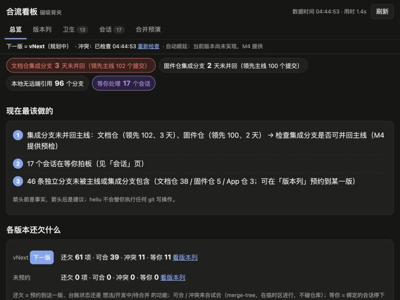

# 合流（heliu）

**合流是一个本机运行的中文版本台账**：它把 git 分支、worktree 和 Claude 桌面应用里的会话对上账，让你随口说的新点子变成功能卡、预约到某一版。
**它解决的是「并行开了十几个会话之后，一版到底还欠什么、哪些能合、哪些在等我」**：看板 10 秒看懂，合并按版本走预演 → 确认 → 合入 → 顺延，不漏、不乱、不偷偷动你的仓库。
**一句话：git 是事实，台账是承诺，看板是对账单。**

## 三句话就能用

在任何 Claude 会话里直接说，或者在终端敲命令：

| 你说 | 终端命令 | 会话里调用的 MCP 工具 |
|---|---|---|
| 「我有个新点子：让背夹支持闹钟」 | `heliu 新点子 "让背夹支持闹钟"`（默认预约到下一版，在 worktree 里会自动绑定当前分支与会话） | `heliu_feature_add` |
| 「1.2 还欠什么？」 | `heliu 待办 v1.2`（加 `--precheck` 在临时区试合，分出「有冲突」） | `heliu_milestone_todo` |
| 「合并 1.2」 | 先 `heliu 合并 v1.2 --预演` 生成合并单 → 看过、改好决定 → `heliu 合并 v1.2`（终端里逐条确认） | `heliu_release_preview`（只出预演；MCP 不提供执行合并的工具，执行要在终端里跑 `heliu 合并`） |

## 安装（三步）

1. **装 bun**（已有可跳过）：`curl -fsSL https://bun.sh/install | bash`
2. **跑安装脚本**：`scripts/install.sh`（想先看会做什么：`scripts/install.sh --dry-run`）。它会：`bun install`（`node_modules` 软链到 `node_modules.nosync`，iCloud 不同步）→ 注册 user 级 MCP `heliu` → 把本仓库加成本地 marketplace `heliu-local` 并安装插件 `heliu@heliu-local`（带 `/heliu` Skill、hooks、MCP）。卸载：`scripts/uninstall.sh`（不删台账与缓存）。
3. **接入你的项目**：`bin/heliu project add <仓库路径>`，向导会猜主线、集成分支、远端、是否在 iCloud，打一张中文摘要等你确认，然后建台账。再 `bin/heliu board --project <项目名>` 打开看板。

想在任何目录直接敲 `heliu`：把 `bin/heliu` 链到你 PATH 里的某个目录，例如 `ln -s "$PWD/bin/heliu" /usr/local/bin/heliu`。`bin/heliu` 是个 sh 包装，自己找 bun，不依赖 PATH 里有 bun。

## 命令速查

全局选项：`--project <名>`（缺省按当前目录识别）· `--json`（稳定 JSON）· `--precheck`（试合）· `--wide`（表格不截断）。

| 想做什么 | 命令 | MCP 工具 |
|---|---|---|
| 项目现在什么情况（健康条 + 现在最该做的） | `heliu status`（`--full` 全部分支长表） | `heliu_status` |
| 某一版还欠什么 | `heliu 待办 [v1.2 / 下一版]`（`--precheck` 分出有冲突） | `heliu_milestone_todo` |
| 登记新点子 | `heliu 新点子 "<一句话>" [--预约 v1.2 / --unreserved / --no-bind]` | `heliu_feature_add` |
| 改预约 | `heliu 预约 F-0003 v1.3`（版本不存在就新建；写 `无` 取消预约） | `heliu_feature_reserve` |
| 我在哪（分支 / 功能卡 / 预约 / 落后多少） | `heliu 我在哪` | `heliu_whereami` |
| 把现有分支登记成草稿卡 | `heliu sync --dry-run` → `heliu sync` | `heliu_sync` |
| 打开看板 | `heliu board [--port 7788] [--no-open]` | — |
| 合并 · 预演（生成合并单，只读仓库） | `heliu 合并 v1.2 --预演`；改决定 `heliu release set v1.2 F-0012 顺延` | `heliu_release_preview`、`heliu_release_plan_set_decision` |
| 合并 · 执行 | `heliu 合并 v1.2`（逐条确认；`--dry-run` 只说明会怎么做；`--to-main` 能快进才快进主线） | 不提供 |
| 合并 · 演练（在克隆上完整跑一遍） | `heliu 演练 v1.2` | — |
| 合并 · 回滚 | `heliu 回滚 v1.2` | — |
| 会话 / 卫生 / 环境 | `heliu sessions` · `heliu hygiene` · `heliu doctor` | `heliu_sessions`、`heliu_hygiene` |
| 里程碑 | `heliu milestone add / list / freeze / rename` | `heliu_milestone_list` |
| 接入新仓库 | `heliu project add <路径> [--integration <分支>] [--ledger repo] [--yes]` | — |

## 工作原理

- **对账（事实，实时算、不落盘）**：每次都用只读 git 命令（`for-each-ref`、`rev-list`、`merge-base`、`merge-tree` 试合等）现算每个分支是否进了主线 / 集成分支、领先落后多少、试合会冲突哪些文件，再和桌面应用的会话记录（标题、在等你回答什么、最后活动）对上。iCloud 仓库的命令都带超时，超时标「未知」，不会卡死。
- **台账（承诺，纯文本）**：`milestones.yaml` + 每张功能卡一个 `features/F-0001-<标题>.md`（frontmatter 记标题、状态、预约到哪一版、绑定的仓库/分支/会话、验收档位、从哪版顺延来）。只记 git 里没有的东西，人可以直接读改。
- **hooks 零额外动作**：插件注册 SessionStart 与 Stop 两个 hook。会话一开始注入「你在哪个分支、对应哪张功能卡、预约哪一版、落后主线多少」；每轮结束把最后活动记进本机缓存。注入的提示会请会话在你明确提出新需求时调用 `heliu_feature_add` 登记（用你的原话当标题），你不用额外操作。
- **看板**：本机网页（只监听 127.0.0.1），总览 / 版本列（拖卡片改预约）/ 卫生 / 会话 / 合并预演，浅深色随系统，手机宽度可看。

## 安全承诺

- **只读**：除了你确认过的 `heliu 合并`（和 `回滚`），所有命令对被管理仓库的 git 数据只读；git 调用走白名单，macOS 上再包一层 `sandbox-exec` 写保护；试合在临时对象区进行；`heliu 演练` 只在缓存目录的克隆上执行。台账如果按 `--ledger repo` 放进仓库，heliu 只写仓库里的 `.heliu/` 目录。
- **合并只写三样东西**：集成分支、版本 tag，以及加了 `--to-main` 且能快进时的主线。有冲突的合并在 `~/.cache/heliu/` 下的临时 worktree 里做，不碰你的工作目录；每次移动引用都先记进合并单，可 `heliu 回滚`。
- **不 push、不 fetch、不删分支、不删 worktree**。远端对比只用本地已有的引用；推送永远由你决定。
- 台账写在你选的位置（缺省 `~/Library/Application Support/heliu/projects/<项目>/ledger/`），数据库只放在 `~/Library/Application Support/heliu/`，不放 iCloud。

## 文档索引

- `docs/02-产品定义/产品定义_v0.1.md`：做什么、为什么、看板信息架构、怎么算做成
- `docs/03-架构/架构决策_v0.1.md`：7 条 ADR（技术栈、数据落点、git 只读纪律、hooks……）
- `docs/03-架构/M1…M5-任务卡.md` 与 `M1…M5-实现说明.md`：每个里程碑的规格与实现细节、实测数字
- `docs/04-验收记录/`：每个里程碑的验收记录（Fable 终验 + Codex 二次验收）、截图、M4 演练报告
- `docs/00-现场证据/`、`docs/01-调研/`：现状快照、竞品与社区调研、Claude Code 接入点核实
- `skills/heliu/SKILL.md`：主控会话里怎么用 heliu 工具

## 已知限制

- 只在 macOS + Bun 1.3 上开发和验证过；写保护沙箱依赖 macOS 的 `sandbox-exec`，没有它时 `--precheck` 试合会被拒绝（看板上显示「未能试合」，不会当成无冲突）。
- iCloud 仓库默认不做工作区脏检查（会触发文件下载），`--dirty` 才查。
- 桌面应用的会话 JSON 没有官方文档：字段变了会逐项降级为「缺失」；目前会话记录里没有 `claude://` 链接，看板的「打开会话」按钮置灰，改为复制会话 ID。
- 合并遇到普通文件冲突时交给 Claude 子代理解，需要本机 `claude` CLI 已登录；真实 Opus 解冲突还没有端到端验证过（见 M4 实现说明）。仓库没配集成分支的项不会被合并（默认顺延）。
- 同时注册 user 级 MCP 和插件时，会话里 heliu 工具会出现两份（插件自带同名 MCP）；只想要一份：`scripts/install.sh --no-mcp`。
- 注册表里有多个项目后，在项目目录之外运行命令需要加 `--project <名>`。
- 看板一次服务一个项目；拖拽改预约只支持桌面浏览器，手机上用卡片展开后的下拉。
