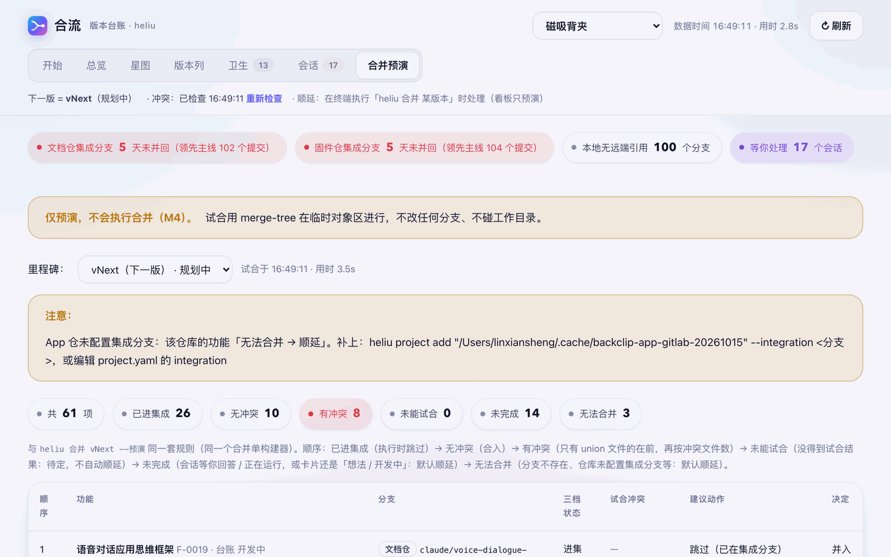

# 合流使用教程（通俗版）

> 这份教程写给第一次用合流的人。不讲原理，只讲"你会遇到什么、该做什么"。看完大约 10 分钟。
> 想看原理和命令全表，去 [README](../README.md)；想看为什么这么设计，去 [产品定义](02-产品定义/产品定义_v0.1.md)。

## 0. 先用一个比喻理解它

你同时开了十几个 Claude 会话，每个会话在一条分支上做一个功能。时间一长，你会忘记三件事：哪个会话在做什么、这一版打算带上哪些功能、哪些功能其实还没做完。

合流做的事，就像给你配了一个记账员：

| 角色 | 它是什么 | 谁负责 |
|---|---|---|
| 账本 | git 里的分支、提交、worktree | git 自己记，合流只读 |
| 承诺清单 | 你说过"这个功能要进 1.2 版" | 合流记在"台账"里 |
| 对账单 | 把账本和承诺清单对一遍：哪些做完了、哪些落后了、哪些在等你 | 合流每次现算，显示在看板和终端里 |

记住一句话就够了：**git 是事实，台账是承诺，看板是对账单。**

## 1. 三个词

- **功能卡**：一个点子、一个需求，就是一张卡。卡上写着标题、在哪条分支、预约到哪一版、现在什么状态。
- **版本**：你准备"合并一版"的那个目标，比如 v1.2。合流里叫里程碑，意思一样。
- **预约**：把一张功能卡放进某个版本。新点子默认预约到"下一版"。合并时没做完的卡会**自动挪到再下一版**，并标上"从 v1.2 顺延"，绝不会悄悄丢掉。

## 2. 确认它已经装好了

打开终端，进到合流的目录（你机器上是 iCloud 里的「项目管理工具」），运行：

```bash
bin/heliu doctor
```

最后一行是「结论：可用，N 项警告」或「结论：一切正常」就行。警告里常见的一条是"无头 claude 未登录"，它只影响合并时自动解冲突这一个功能，后面会讲。

再新开一个磁吸背夹的会话，输入 `/heliu`，能看到 `/heliu:heliu` 这个技能，说明插件也装好了。

## 3. 打开看板

最省事的办法：在 Finder 里双击合流目录里的 **「合流看板.command」**。它会开一个终端窗口跑看板，并打开浏览器。关掉那个终端窗口就退出看板；看板已经开着时再双击，只会把浏览器带过去。

用终端也一样：

```bash
bin/heliu board
```

地址是 `http://127.0.0.1:7788/`，只有你这台电脑能访问。第一次打开会落在 **「开始」页**，照着五步做就行：检查环境、接入项目、把现有分支登记成卡、登记新点子、复制合并命令。接入项目时只需粘贴仓库路径（Finder 里选中文件夹按 ⌥⌘C 复制路径）。顶栏的下拉框用来切换项目。

看板一共七页。日常先看「总览」：


从上往下三块：

1. **健康条**：每个仓库一行。红框表示集成分支已经好几天没并回主线，这是最该先处理的事。
2. **现在最该做的**：最多三句话。箭头前面是事实，箭头后面是建议。
3. **各版本还欠什么**：下一版还欠几项、能合几项、有几项在等你。

## 4. 日常只有四个动作

### 动作一：有了新点子

像往常一样，在 Claude 桌面应用里新开一个会话，把需求说出来。比如："做个闹钟功能，先并行做着。"

会话一开始，合流会自动告诉 Claude 它在哪条分支、有没有功能卡。Claude 在明确需求后会自动登记一张卡，预约到下一版。你不用填任何表单。

想确认登记成功了，有三种办法，任选一种：

- 在会话里问一句："下一版还欠什么？"
- 看板「版本列」里多了一张新卡。
- 终端运行 `bin/heliu 待办 下一版 --project 磁吸背夹`。

如果你想手动登记，也可以在终端里说：

```bash
bin/heliu 新点子 "让背夹支持闹钟" --project 磁吸背夹
```

### 动作二：想知道这一版还欠什么

三种方式结果一样：

- 会话里直接问："1.2 还欠什么？"
- 看板「版本列」，看 v1.2 那一列。
- 终端：

```bash
bin/heliu 待办 v1.2 --project 磁吸背夹
```

结果按紧急程度分组，每张卡只出现在最靠前的一组里：

| 分组 | 意思 | 你该做什么 |
|---|---|---|
| 等你回答 | 那个会话停下来在等你拍板，下面会写明等什么 | 回到那个会话回答它 |
| 有冲突 | 试着合了一下，发现会和别的改动打架 | 合并时让 Claude 解冲突，或者先同步基线 |
| 可合并 | 已经进了集成分支，或者试合没冲突 | 不用管，合并时会带上 |
| 落后需同步 | 这条分支开得早，主线后来又进了很多东西 | 合并前最好先同步一次（见第 6 节） |
| 停滞 | 7 天没动静 | 决定是继续、还是标记放弃 |
| 开发中 | 正在做，还没提交或还没做完 | 等它 |
| 尚未关联开发分支 | 只是个想法，还没开会话 | 需要时给它开个会话 |

### 动作三：某张卡想换个版本

- 看板上：把卡片从一列拖到另一列，松手就生效，页面下方会提示"已写入台账"。拖到「未预约」列就是取消预约。
- 终端：

```bash
bin/heliu 预约 F-0012 v1.3 --project 磁吸背夹
```

卡号 `F-0012` 在卡片和待办列表里都能看到。版本不存在会自动新建。


### 动作四：合并一版

这是唯一会真正改动你仓库的动作，所以分三步，每步都能反悔。

**第一步，预演。** 只看不做：

```bash
bin/heliu 合并 v1.2 --预演 --project 磁吸背夹
```

它会生成一张"合并单"，按顺序列出：哪些已经在集成分支里（跳过）、哪些没冲突（直接合）、哪些有冲突（需要解）、哪些试合没成功（请你人工确认）、哪些还没做完（默认顺延）。看板的「合并预演」页显示的是同一张单子。



**第二步，改决定。** 不同意默认安排就改。比如某张卡你想等它做完再合：

```bash
bin/heliu release set v1.2 F-0012 等它 --project 磁吸背夹
```

决定只有四种：并入、顺延、等它、不并。

**第三步，执行。**

```bash
bin/heliu 合并 v1.2 --project 磁吸背夹
```

执行前它会再打印一遍摘要：新增合入几项、已在集成几项、顺延几项（分原因）。你要**手动输入 yes** 才会开始，直接回车等于取消。

执行完会：把功能合进集成分支、打一个 v1.2 的 tag、生成发布说明、把没做完的卡顺延到下一版。它**不会 push**。推不推、什么时候推，由你决定。

**反悔了？** 一条命令退回去：

```bash
bin/heliu 回滚 v1.2 --project 磁吸背夹
```

**第一次合并前，建议先演练一遍。** 演练会在 `~/.cache/heliu/` 下克隆一份仓库，在克隆上完整走一遍，真仓库一个字节都不动：

```bash
bin/heliu 演练 v1.2 --project 磁吸背夹
```

## 5. 看板其他几页

### 星图：一眼看清所有分支

星图是深色星空风格的分支关系图。

- **横着看是时间**：越靠右越新。最新的三条分支会发光呼吸，并标出金色「★ 最新」。
- **竖着看是仓库**：每个仓库一条泳道，底部两条发光的"河"分别是主线和集成分支。
- **星点的颜色**和版本列的灯一样：紫 = 等你回答，红 = 有冲突，绿 = 可合并，黄 = 落后需同步，灰 = 开发中或停滞，蓝色虚边 = 还没有功能卡。
- **右边的行星**是版本。悬停在行星上，会亮出所有预约到这一版的连线。

在星图里可以直接拖：

| 拖什么 | 放到哪 | 结果 |
|---|---|---|
| 星点 | 版本行星 | 预约到这一版；还没卡的分支会自动建一张卡 |
| 星点 | 行星旁的小星星（还没关联分支的卡） | 把这条分支绑到那张卡上 |
| 星点 | 「未预约」 | 取消预约 |
| 星点 | 泳道右端的「合流点」 | 排进这一版的合并单，决定是「并入」，马上告诉你试合有没有冲突 |

拖到合流点不会真的合并代码，它只是把这一项写进合并单。真正合并还是第 4 节的「执行」那一步：在终端输入 yes 才开始。

点一下星点会弹出详情：分支名、最后提交时间、落后多少、在等你什么。手机上不方便拖，就在详情里用下拉框和按钮做同样的事。


### 其他页

| 页 | 看什么 | 什么时候看 |
|---|---|---|
| 版本列 | 每版一列，卡片按分组排，顶部能直接登记新点子 | 每天开工时扫一眼 |
| 卫生 | worktree 目录和分支对不上、残留的锁文件、已合并但目录还在 | 感觉仓库乱了的时候；它只给建议命令，不动手 |
| 会话 | 所有会话按"等你 / 运行中 / 已完成 / 已归档"分组，等你的会写明在等什么 | 想知道有几个会话在等你 |
| 合并预演 | 同第 4 节第一步 | 准备合并前 |


## 6. 几种常见情况怎么办

**卡片显示"落后 ↓102"是什么意思？**
这条分支开出来之后，集成分支又进了 102 个提交。它没拿到那些新东西。合并前最好先同步。做法：展开卡片，点「复制给 Claude 会话」，到那条分支的会话里粘贴，Claude 会把集成分支合进来并解决冲突。合流自己不会动这条分支。

**卡片显示"等你回答"，可我早就处理过了？**
这是那个会话最后一次记录的请求，可能已经过期。回到会话里再说一句话，状态就会更新。

**卡片显示"未能试合"？**
试合需要 macOS 的写保护沙箱，偶尔会建不起来。这不等于没冲突。重新点一下看板顶部的「重新检查」，或者在合并时人工确认。

**卡片显示"已合入 · 待确认台账"？**
分支已经进了集成分支，但卡片状态还没改。点卡片上的「标为已合入」就行。合流不会替你改状态。

**合并时遇到冲突，Claude 没来解？**
看 `bin/heliu doctor` 里"无头 claude"那一行。如果写着"未登录"，在终端执行一次 `claude login` 就好。没登录时合流会把那一项标为"失败·待处理"，不会花钱也不会瞎改。

**我接入的仓库在 iCloud 上，命令会不会卡住？**
不会。对 iCloud 仓库的命令都带超时，超时会显示"未知"而不是卡死。默认也不检查工作区文件是否改动，需要时加 `--dirty`。

## 7. 它保证不做的事

- 不 push、不 fetch。
- 不删分支、不删 worktree、不删任何文件。
- 除了你输入 yes 确认的那次合并，对你的仓库完全只读。
- 台账和缓存放在 `~/Library/Application Support/heliu/`，不放 iCloud。

## 8. 接入第二个项目

在看板「开始」页点「＋ 接入新项目」，或者顶栏下拉里选「＋ 接入新项目…」，粘贴路径、确认即可。项目名填成已有项目的名字，就会把这个仓库加进那个项目（适合把固件仓、App 仓并进同一个项目）。

终端写法：

```bash
bin/heliu project add /路径/到/你的仓库
```

它会猜主线、集成分支、远端，打一张中文摘要让你确认，然后建台账。猜错了用 `--integration 分支名` 指定。脚本或 Claude 调用时加 `--yes` 就不会停下来问。

接入后用 `--project 项目名` 切换项目，比如 `bin/heliu status --project 项目名`。

## 9. 出问题先看这里

| 现象 | 先试 |
|---|---|
| 任何命令报错 | `bin/heliu doctor`，按 ✗ 那几行处理 |
| 看板打不开 | 端口被占就换一个：`--port 7789` |
| 会话里没有 heliu 工具 | 用桌面应用内置的 claude 跑 `plugin list`，确认有 `heliu@heliu-local` 且 enabled；没有就在合流目录重跑 `scripts/install.sh` |
| 待办里少了一张我记得有的卡 | `bin/heliu feature list --project 磁吸背夹` 看全部；状态是"已合入 / 已放弃"的卡不计入待办 |
| 想把现有分支都登记成卡 | `bin/heliu sync --dry-run --project 磁吸背夹` 先预览，再去掉 `--dry-run` |

## 10. 一张速查卡

```text
看一眼        bin/heliu status --project 磁吸背夹
开看板        bin/heliu board --project 磁吸背夹
还欠什么      bin/heliu 待办 下一版 --project 磁吸背夹
登记点子      bin/heliu 新点子 "一句话" --project 磁吸背夹
换版本        bin/heliu 预约 F-0012 v1.3 --project 磁吸背夹
我在哪        bin/heliu 我在哪
合并·预演     bin/heliu 合并 v1.2 --预演 --project 磁吸背夹
合并·改决定   bin/heliu release set v1.2 F-0012 顺延 --project 磁吸背夹
合并·演练     bin/heliu 演练 v1.2 --project 磁吸背夹
合并·执行     bin/heliu 合并 v1.2 --project 磁吸背夹     （输入 yes 才执行）
合并·反悔     bin/heliu 回滚 v1.2 --project 磁吸背夹
体检          bin/heliu doctor      bin/heliu hygiene
```

在 Claude 会话里，这些都可以用一句话代替：
"下一版还欠什么" · "这个预约到 1.3" · "我现在在做哪个功能" · "帮我把现有分支登记一下"。
