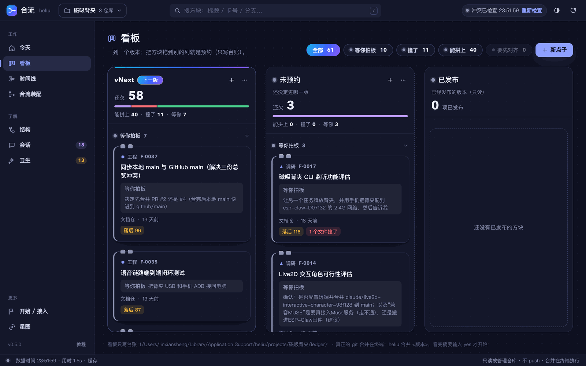
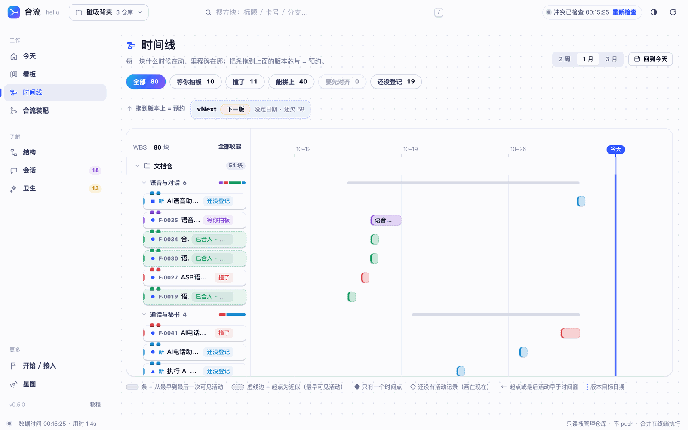

# 合流使用教程（通俗版）

> 这份教程写给第一次用合流的人。不讲原理，只讲"你会遇到什么、该做什么"。看完大约 10 分钟。
> 想看原理和命令全表，去 [README](../README.md)；想看为什么这么设计，去 [产品定义](02-产品定义/产品定义_v0.1.md)。

## 0. 先用一个比喻理解它

你同时开了十几个 Claude 会话，每个会话在一条分支上做一个功能。时间一长，你会忘记三件事：哪个会话在做什么、这一版打算带上哪些功能、哪些功能其实还没做完。

合流做的事，就像给你配了一个记账员：

| 角色 | 它是什么 | 谁负责 |
|---|---|---|
| 账本 | git 里的分支、提交、worktree | git 自己记，合流只读 |
| 承诺清单 | 你说过"这个功能要进 1.2 版" | 合流记在"台账"里 |
| 对账单 | 把账本和承诺清单对一遍：哪些做完了、哪些落后了、哪些在等你 | 合流每次现算，显示在看板和终端里 |

记住一句话就够了：**git 是事实，台账是承诺，看板是对账单。**

## 1. 三个词

- **功能卡**：一个点子、一个需求，就是一张卡。卡上写着标题、在哪条分支、预约到哪一版、现在什么状态。
- **版本**：你准备"合并一版"的那个目标，比如 v1.2。合流里叫里程碑，意思一样。
- **预约**：把一张功能卡放进某个版本。新点子默认预约到"下一版"。合并时没做完的卡会**自动挪到再下一版**，并标上"从 v1.2 顺延"，绝不会悄悄丢掉。

## 2. 确认它已经装好了

打开终端，进到合流的目录（你机器上是 iCloud 里的「项目管理工具」），运行：

```bash
bin/heliu doctor
```

最后一行是「结论：可用，N 项警告」或「结论：一切正常」就行。警告里常见的一条是"无头 claude 未登录"，它只影响合并时自动解冲突这一个功能，后面会讲。

再新开一个磁吸背夹的会话，输入 `/heliu`，能看到 `/heliu:heliu` 这个技能，说明插件也装好了。

doctor 里还有三行「装进 Claude」，都打 ✓ 才算全装好：

- **插件**：会话里有 `heliu_*` 工具和 `/heliu`。
- **全局入口**：你的 `~/CLAUDE.md` 末尾有一段「合流（heliu）版本台账规则」，告诉每个会话什么时候该用合流，比如你说新点子就登记、合并完提醒同步、没接入的仓库建议你接入（它不会自己接入）。
- **终端命令**：终端里能直接敲 `heliu`。

哪一行打 `!`，就在合流目录运行一次 `scripts/install.sh`。重复运行没有坏处：全局入口只更新带标记的那一段，你自己写的规则一个字都不动，改之前还会备份。已经开着的会话要重开才读得到。

## 3. 打开看板

最省事的办法是装一个 **合流 App**：在合流目录运行一次

```bash
scripts/build-app.sh --install
```

之后在启动台或聚焦搜索里打开「合流」就行。它是一个独立窗口，自己在后台把看板跑起来；按 ⌘Q 退出 App，看板也一起停。它用的是主仓库的代码，拉了新代码以后重开 App 就是新版。

不想装 App：在 Finder 里双击合流目录里的 **「合流看板.command」**。它会开一个终端窗口跑看板，并打开浏览器。关掉那个终端窗口就退出看板；看板已经开着时再双击，只会把浏览器带过去。

用终端也一样：

```bash
bin/heliu board
```

地址是 `http://127.0.0.1:7788/`，只有你这台电脑能访问。第一次打开会落在 **「开始」页**，照着五步做就行：检查环境、接入项目、把现有分支登记成卡、登记新点子、复制合并命令。接入项目时只需粘贴仓库路径（Finder 里选中文件夹按 ⌥⌘C 复制路径）。顶栏的下拉框用来切换项目。

合流长得像一个本地客户端：左侧栏选页面，中间是一块块**积木方块**，点任何一块右侧滑出详情，底部状态栏写着数据时间。日常先看「今天」：


从上往下：

1. **下一版大方块**：下一版是谁、还欠几块、分段条上 绿 能拼上 / 黄 要先对齐 / 红 撞了 / 紫 等你拍板 / 灰 还在做 各占多少。点图例直接跳到看板对应的一组。
2. **我有个新点子…**：一句话回车就登记，默认预约到下一版。
3. **现在最该做的**：每句一个按钮，箭头前面是事实，箭头后面是建议。
4. **最近动的**：最近有动静的六块，可以直接拖到上面的「下一版」里预约。
5. **健康**：集成分支几天没并回主线、几条分支本地没有远端引用、几个会话在等你。

**一种方块，到处一样。** 每条功能在今天、看板、时间线、合流装配里都是同一块积木：顶上两颗「积木钉」的颜色就是状态，第一行永远是人话——能拼上 / 要先对齐 / 撞了 / 等你拍板 / 还在做 / 还没登记，事实（落后几个提交、几个文件撞了）放在小芯片里。点一块，右侧详情里能改预约、类型、模块、状态，看每条分支的事实，复制给 Claude 的「同步基线」「解冲突」指令。

## 4. 日常只有四个动作

### 动作一：有了新点子

像往常一样，在 Claude 桌面应用里新开一个会话，把需求说出来。比如："做个闹钟功能，先并行做着。"

会话一开始，合流会自动告诉 Claude 它在哪条分支、有没有功能卡。Claude 在明确需求后会自动登记一张卡，预约到下一版。你不用填任何表单。

想确认登记成功了，有三种办法，任选一种：

- 在会话里问一句："下一版还欠什么？"
- 看板里多了一块新方块（「今天」的「最近动的」和看板的下一版列都能看到）。
- 终端运行 `bin/heliu 待办 下一版 --project 磁吸背夹`。

如果你想手动登记，也可以在终端里说：

```bash
bin/heliu 新点子 "让背夹支持闹钟" --project 磁吸背夹
```

### 动作二：想知道这一版还欠什么

三种方式结果一样：

- 会话里直接问："1.2 还欠什么？"
- 看板「看板」页，看 v1.2 那一列；或「合流装配」选 v1.2，左边按能不能拼上分堆。
- 终端：

```bash
bin/heliu 待办 v1.2 --project 磁吸背夹
```

结果按紧急程度分组，每张卡只出现在最靠前的一组里：

| 分组 | 意思 | 你该做什么 |
|---|---|---|
| 等你回答 | 那个会话停下来在等你拍板，下面会写明等什么 | 回到那个会话回答它 |
| 有冲突 | 试着合了一下，发现会和别的改动打架 | 合并时让 Claude 解冲突，或者先同步基线 |
| 可合并 | 已经进了集成分支，或者试合没冲突 | 不用管，合并时会带上 |
| 落后需同步 | 这条分支开得早，主线后来又进了很多东西 | 合并前最好先同步一次（见第 6 节） |
| 停滞 | 7 天没动静 | 决定是继续、还是标记放弃 |
| 开发中 | 正在做，还没提交或还没做完 | 等它 |
| 尚未关联开发分支 | 只是个想法，还没开会话 | 需要时给它开个会话 |

### 动作三：某张卡想换个版本

- 看板上：把方块从一列拖到另一列，松手就生效，底部提示「已写入台账」并给 5 秒「撤销」。拖到「未预约」列就是取消预约；拖到已发布的列会被拒绝并说明原因。时间线里把一条拖到顶部的版本芯片、「今天」里把方块拖进「下一版」大方块，效果一样；手机上不方便拖，就点开方块在详情里用「预约」下拉改。
- 终端：

```bash
bin/heliu 预约 F-0012 v1.3 --project 磁吸背夹
```

卡号 `F-0012` 在卡片和待办列表里都能看到。版本不存在会自动新建。



### 动作四：合并一版

这是唯一会真正改动你仓库的动作，所以分三步，每步都能反悔。

**第一步，预演。** 只看不做：

```bash
bin/heliu 合并 v1.2 --预演 --project 磁吸背夹
```

它会生成一张"合并单"，按顺序列出：哪些已经在集成分支里（跳过）、哪些没冲突（直接合）、哪些有冲突（需要解）、哪些试合没成功（请你人工确认）、哪些还没做完（默认顺延）。看板的「合并预演」页显示的是同一张单子。


**第二步，改决定。** 不同意默认安排就改。比如某张卡你想等它做完再合：

```bash
bin/heliu release set v1.2 F-0012 等它 --project 磁吸背夹
```

决定只有四种：并入、顺延、等它、不并。

**第三步，执行。**

```bash
bin/heliu 合并 v1.2 --project 磁吸背夹
```

执行前它会再打印一遍摘要：新增合入几项、已在集成几项、顺延几项（分原因）。你要**手动输入 yes** 才会开始，直接回车等于取消。

执行完会：把功能合进集成分支、打一个 v1.2 的 tag、生成发布说明、把没做完的卡顺延到下一版。它**不会 push**。推不推、什么时候推，由你决定。

**反悔了？** 一条命令退回去：

```bash
bin/heliu 回滚 v1.2 --project 磁吸背夹
```

**第一次合并前，建议先演练一遍。** 演练会在 `~/.cache/heliu/` 下克隆一份仓库，在克隆上完整走一遍，真仓库一个字节都不动：

```bash
bin/heliu 演练 v1.2 --project 磁吸背夹
```

**不想记命令？用拖的。** 在「星图」里把右边的**版本行星拖到「合流点」**，看板会刷新这一版的合并单，并把一段合并 Prompt 复制到剪贴板。把它粘贴进任意一个 Claude 会话，Claude 会：

1. 先运行预演，用中文告诉你会合入什么、顺延什么、哪里有冲突；
2. **不替你合并**——Prompt 里写明了，也不带 `--yes`；你在终端自己运行上面「第三步」的命令，输入 yes 才开始；
3. 你说"合完了"之后，运行同步命令，把台账补上并汇报。

**合并完，记得同步一下。** 如果你是在别处合的（比如在某个会话里手动 merge 了），台账不会自动知道。回到看板点 **「刚合并完？同步一下」**：它重新对账，列出"分支已经被集成分支或主线包含、台账还是旧状态"的卡，你勾选后才写进去。只改台账、不碰仓库，状态只往前改。终端里也一样：

```bash
bin/heliu 同步合并结果 --dry-run --project 磁吸背夹   # 先看看
bin/heliu 同步合并结果 --project 磁吸背夹             # 写进台账
```

## 5. 看板其他几页

### 看板：一列一个版本

列 = 版本（按 milestones.yaml 的顺序）+ 未预约 + 已发布。列头有「还欠 N」和一条分段条；列内按 等你拍板 → 撞了 → 能拼上 → 要先对齐 → 还在做 → 没动静 分组，默认只展开前两组。顶部的筛选芯片和标题栏的搜索框一起过滤。列头的「＋」在本列直接登记新点子，「⋯」里能复制这一版的合并 Prompt。

### 时间线：每块什么时候在动

左边是 仓库 → 模块 → 方块 的 WBS 树（可折叠），右边是时间轴：每块从最早可见活动到最后活动画一条，颜色和方块一样；今天是一条实线，里程碑写了目标日期就有一条虚线。起点拿不到精确值时条是虚线边、提示写明「近似」。范围可选 2 周 / 1 月 / 3 月。

- 把一条拖到顶部的版本芯片 = 预约；没登记的分支（蓝色）拖过去 = 顺手建卡再预约。
- 把一条拖到左栏的模块名 = 改模块。
- 每个仓库下面还有一行「会话入口 N」：那些分支没有自己的提交，只是开会话时顺手建的，不画成条。



### 合流装配：把方块摆上轨道

这是第 4 节「合并一版」的图形版，但**只排单、不合并**。

- 选一个版本（默认下一版）。左边「这一版的方块」按 能拼上 / 已在集成分支 / 撞了 / 没试出来 / 还没做完 / 拼不上 分堆，和终端 `heliu 合并 <版本> --预演` 同一套规则。
- 右边的「合流轨道」从上到下就是合并顺序：每个槽位一块方块、试合结果（撞了几个文件可展开）、一个 并入 / 待定 / 不并 / 顺延 的开关。把左边的方块拖进轨道 = 排进合并单、决定为「并入」；切开关 = 改决定。都只写合并单文件，不动仓库。
- 底部一直有「生成合并单」「复制合并 Prompt」两个按钮，和一句粗体：看板只排单，不执行合并，在终端运行 `heliu 合并 <版本>`、输入 yes 才开始。


### 星图：旧版的宇宙视图（在「更多」里）

星图是深色星空风格的分支关系图。

- **横着看是时间**：越靠右越新。最新的三条分支会发光呼吸，并标出金色「★ 最新」。
- **竖着看是仓库**：每个仓库一条泳道，底部两条发光的"河"分别是主线和集成分支。
- **星点的颜色**和方块的积木钉一样：紫 = 等你回答，红 = 有冲突，绿 = 可合并，黄 = 落后需同步，灰 = 开发中或停滞，蓝色虚边 = 还没有功能卡。
- **右边的行星**是版本。悬停在行星上，会亮出所有预约到这一版的连线。
- **每条泳道按类型分行**：修复 ◆、功能 ●、调研 ▲、文档 ■、工程 ⬢、其他 ○。默认每行收成一个"星团"：一条带子上的小点是每条分支的时间，旁边写着几条、几条在等你、最新多久前。点左边的行头或星团就展开成一颗颗星点，再点一下收起；「全部展开」一键切换。搜索或点上面的筛选时，有命中的行会自动展开。
- **形状表示类型，颜色表示状态**。类型是按标题、分支名里的关键词猜的，猜错了就把星点拖到正确的行头上，或者在详情里改，改一次就记住。
- **每条泳道最下面一行是「会话入口」**（空心小点）：这些分支一个提交都没有，只是你开会话时桌面应用顺手建的。真正的代码可能改在别的仓库里。它们不算"还没建卡"，默认收起；会话在等你时照样标「等你」。
- **点一颗星，同一张卡在别的仓库的星会一起亮**，并用虚线连起来；详情里也会写「同一张卡：固件仓 feat/xxx」。

在星图里可以直接拖：

| 拖什么 | 放到哪 | 结果 |
|---|---|---|
| 星点 | 版本行星 | 预约到这一版；还没卡的分支会自动建一张卡 |
| 星点 | 行星旁的小星星（还没关联分支的卡） | 把这条分支绑到那张卡上 |
| 星点 | 「未预约」 | 取消预约 |
| 星点 | 泳道右端的「合流点」 | 排进这一版的合并单，决定是「并入」，告诉你试合有没有冲突，并复制合并 Prompt |
| 星点 | 左边的类型行头 | 改类型 |
| 版本行星 | 「合流点」 | 合并这一版：复制合并 Prompt（见第 4 节"用拖的"） |

拖到合流点不会真的合并代码，它只是写合并单、复制 Prompt。真正合并还是第 4 节的「执行」那一步：在终端输入 yes 才开始。

点一下星点会弹出详情：分支名、最后提交时间、落后多少、在等你什么。手机上不方便拖，就在详情里用下拉框和按钮做同样的事。


### 结构：整机由哪些部分组成、现在该决定什么

分支多到看不过来时看这一页。它把所有功能卡和还没建卡的分支，按"模块 × 类型"收好：

- **现在该决定的**：几个大数字——等你回答、有冲突、已合入待确认、可合并、落后需同步、还没建卡。点一个数字，下面列出这一类的全部条目；每条有「星图里看」，点了直接跳到星图里那颗星。点「已合入待确认」会顺手打开「同步一下」。
- **模块 × 类型**：一张表看出整机由哪些模块组成（语音与对话、界面与交互、固件与连接……），每块是在修 bug 还是在加功能。格子越深条数越多，带小红点的格子里有等你或有冲突的。点格子跳到那个模块。
- **模块卡**：每个模块的进度、各状态有几条、最需要你决定的三项。点「展开全部」能看到所有条目，并直接改类型、改模块。

**跨仓配对**：如果你习惯在文档仓开会话、去固件仓改代码，同一件事就会被拆开：会话挂在文档仓的卡上，固件分支要么另有一张卡，要么根本没卡。点「现在该决定的」里的「跨仓配对」：

1. 第一次先点「分析对话记录」。合流只读本机对话记录，只记"会话在哪个 worktree 里出现过、改过几次文件、提交过几次"，不存对话文字，几秒钟就好。
2. 面板按会话列出建议。每条写着依据，比如「esp_claw-callsec：出现 1613 次 · 改文件 3 次 · 提交 38 次」，分强、中、弱三档，强档默认勾好。
3. 看一遍，点「绑定所选」。固件分支就绑到会话的那张卡上了；会话还没有卡的，会用会话标题新建一张，两边一起绑上。只写台账，不碰仓库。

几种情况它只提示、不替你做：分支已经绑在别的卡上（是不是同一件事你来定）、会话直接在固件集成分支上改的（集成分支不能绑卡）、仓库主目录（它常换分支，所以只算弱证据）。终端里对应 `bin/heliu 配对`，确认用 `--确认 编号`。

结构页页脚还会写「另有 N 条会话入口分支」。如果你的会话几乎都开在同一个仓库，会建议给它改个如实的名字，比如「文档仓」改成「总仓（会话入口 + 文档）」。点「改名」只改 project.yaml 里那一行。

模块的划分是内置的通用词典。想换成你自己的，在台账目录放一个 `modules.yaml`：

```yaml
modules:
  - name: 语音与对话
    keywords: [语音, asr, tts, 唤醒]
  - name: 外壳与结构
    keywords: [外壳, 结构, 模具]
```


### 其他页

| 页 | 看什么 | 什么时候看 |
|---|---|---|
| 会话 | 所有会话按"等你 / 运行中 / 已完成 / 已归档"分组，等你的会写明在等什么 | 想知道有几个会话在等你 |
| 卫生 | worktree 目录和分支对不上、残留的锁文件、已合并但目录还在 | 感觉仓库乱了的时候；它只给建议命令，不动手 |
| 开始 / 接入 | 检查环境、接入项目、把现有分支登记成卡、复制合并命令 | 第一次用，或接第二个项目 |

标题栏右边可以切换外观（跟随系统 / 浅色 / 深色）、重新做一次冲突检查、刷新；标题栏中间的搜索框（按 `/` 聚焦）在每一页里过滤方块。

## 6. 几种常见情况怎么办

**卡片显示"落后 ↓102"是什么意思？**
这条分支开出来之后，集成分支又进了 102 个提交。它没拿到那些新东西。合并前最好先同步。做法：展开卡片，点「复制给 Claude 会话」，到那条分支的会话里粘贴，Claude 会把集成分支合进来并解决冲突。合流自己不会动这条分支。

**卡片显示"等你回答"，可我早就处理过了？**
这是那个会话最后一次记录的请求，可能已经过期。回到会话里再说一句话，状态就会更新。

**卡片显示"未能试合"？**
试合需要 macOS 的写保护沙箱，偶尔会建不起来。这不等于没冲突。重新点一下看板顶部的「重新检查」，或者在合并时人工确认。

**卡片显示"已合入 · 待确认台账"？**
分支已经进了集成分支，但卡片状态还没改。点卡片上的「标为已合入」就行。合流不会替你改状态。

**合并时遇到冲突，Claude 没来解？**
看 `bin/heliu doctor` 里"无头 claude"那一行。如果写着"未登录"，在终端执行一次 `claude login` 就好。没登录时合流会把那一项标为"失败·待处理"，不会花钱也不会瞎改。

**我明明大部分时间在改固件，为什么文档仓的分支最多？**
因为会话都是在文档仓里开的，桌面应用会给每个会话在那里建一条分支，哪怕那条分支上什么都没改。星图把这种"会话入口"单独收在一行，不和真实工作混在一起；再用结构页的「跨仓配对」，把会话和它在固件仓真正改的分支连到同一张卡。

**我接入的仓库在 iCloud 上，命令会不会卡住？**
不会。对 iCloud 仓库的命令都带超时，超时会显示"未知"而不是卡死。默认也不检查工作区文件是否改动，需要时加 `--dirty`。

## 7. 它保证不做的事

- 不 push、不 fetch。
- 不删分支、不删 worktree、不删任何文件。
- 除了你输入 yes 确认的那次合并，对你的仓库完全只读。
- 台账和缓存放在 `~/Library/Application Support/heliu/`，不放 iCloud。

## 8. 接入第二个项目

在看板「开始」页点「＋ 接入新项目」，或者顶栏下拉里选「＋ 接入新项目…」，粘贴路径、确认即可。项目名填成已有项目的名字，就会把这个仓库加进那个项目（适合把固件仓、App 仓并进同一个项目）。

终端写法：

```bash
bin/heliu project add /路径/到/你的仓库
```

它会猜主线、集成分支、远端，打一张中文摘要让你确认，然后建台账。猜错了用 `--integration 分支名` 指定。脚本或 Claude 调用时加 `--yes` 就不会停下来问。

接入后用 `--project 项目名` 切换项目，比如 `bin/heliu status --project 项目名`。

## 9. 出问题先看这里

| 现象 | 先试 |
|---|---|
| 任何命令报错 | `bin/heliu doctor`，按 ✗ 那几行处理 |
| 看板打不开 | 端口被占就换一个：`--port 7789` |
| 会话里没有 heliu 工具 | 先看 `bin/heliu doctor` 的「装进 Claude」三行；打 `!` 就在合流目录重跑 `scripts/install.sh`，然后重开会话 |
| 待办里少了一张我记得有的卡 | `bin/heliu feature list --project 磁吸背夹` 看全部；状态是"已合入 / 已放弃"的卡不计入待办 |
| 想把现有分支都登记成卡 | `bin/heliu sync --dry-run --project 磁吸背夹` 先预览，再去掉 `--dry-run` |

## 10. 一张速查卡

```text
看一眼        bin/heliu status --project 磁吸背夹
开看板        bin/heliu board --project 磁吸背夹
还欠什么      bin/heliu 待办 下一版 --project 磁吸背夹
登记点子      bin/heliu 新点子 "一句话" --project 磁吸背夹
换版本        bin/heliu 预约 F-0012 v1.3 --project 磁吸背夹
我在哪        bin/heliu 我在哪
合并·预演     bin/heliu 合并 v1.2 --预演 --project 磁吸背夹
合并·改决定   bin/heliu release set v1.2 F-0012 顺延 --project 磁吸背夹
合并·演练     bin/heliu 演练 v1.2 --project 磁吸背夹
合并·执行     bin/heliu 合并 v1.2 --project 磁吸背夹     （输入 yes 才执行）
合并·反悔     bin/heliu 回滚 v1.2 --project 磁吸背夹
合并后同步    bin/heliu 同步合并结果 --project 磁吸背夹   （--dry-run 只看）
改类型        bin/heliu 分类 F-0012 --type 修复 --module 语音与对话
跨仓配对      bin/heliu 配对 --project 磁吸背夹         （--确认 3,5 才写）
改仓库名      bin/heliu project set-label docs "总仓（会话入口 + 文档）"
体检          bin/heliu doctor      bin/heliu hygiene
```

在 Claude 会话里，这些都可以用一句话代替：
"下一版还欠什么" · "这个预约到 1.3" · "我现在在做哪个功能" · "帮我把现有分支登记一下"。
